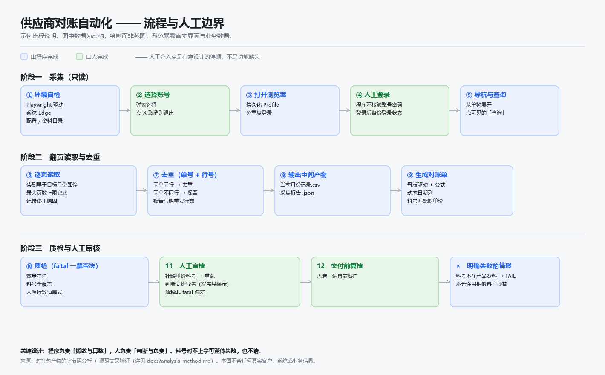

# erp-reconciliation-skill

**ERP 对账自动化案例研究** —— 业务流程图解、确定性规则设计、自动化边界与风险控制。

把「人工从 ERP 网页抄送货单、再手工拼对账单」这件事，拆解成一个**可描述的、规则确定的**流程，
并说明哪些环节能自动化、哪些必须留给人。

> **定位说明**：本仓库是**案例研究**，不是可安装运行的软件产品。
> 它不含可运行的完整实现，也不声称能直接用于任何真实 ERP 环境。
> 详见下方「实际验证情况」与「当前局限」。

> **本仓库是脱敏案例说明，不含任何真实客户、公司、料号、单价或业务数据。**
> 文中所有名称、编号、金额均为虚构；示例数据由脚本生成。
> 关于工具来源与本次分析方法的说明，见 [docs/analysis-method.md](docs/analysis-method.md)。



上图标出了流程里**哪些环节由程序完成、哪些必须由人完成**。分界线是有意设计的，不是功能缺失。

---

## 它解决什么业务问题

制造业供应商每月要向客户对账。对账的依据是客户 ERP 系统里记录的**当月送货单**：哪天送了哪个料号、多少件、单价多少，最后算出这个月的货款总额。

麻烦在于：

- 送货单在**客户的 ERP 网页**里，只能一条条翻页看，没有导出
- 一个月的记录分散在多页，日期列还可能变化（这个月有几天业务，就有几列）
- 手工抄到 Excel 母版里，容易错行、漏单、重复计数
- 单价要另外从产品资料里查，漏填就会算错金额

工具把前三步自动化，第四步由产品资料驱动，最后用一套质检规则确认结果自洽。

---

## 原来的流程 vs 现在的流程

### 原来（全人工）

| 步骤 | 做法 | 风险 |
|---|---|---|
| 1 | 登录客户 ERP 网页 | — |
| 2 | 进入「供应商送货单」列表，按月份查询 | — |
| 3 | **逐页手抄**每一条记录到 Excel | 错行、漏单、重复 |
| 4 | 按料号去产品资料里查单价 | 漏查导致金额错 |
| 5 | 按日期手工插入列，把数量填到对应格子 | 日期列与数据错位 |
| 6 | 核对合计 | 前几步的错会累积到这里才发现 |

### 现在

| 步骤 | 由谁完成 | 说明 |
|---|---|---|
| 1 | **人工** | 在自动打开的浏览器里登录（程序不接触账号密码） |
| 2 | 程序 | 自动进菜单、查询、翻页读取全部记录 |
| 3 | 程序 | 输出结构化记录（CSV/JSON）+ 采集报告 |
| 4 | 程序 | 按料号匹配产品资料取单价；**找不到就明确失败，不猜** |
| 5 | 程序 | 按「单据日期 + 料号」汇总，动态生成日期列 |
| 6 | 程序 | 跑质检项并输出报告，人工只需看报告结论 |

人工从「抄几百行数据」变成「登录一次 + 看一份报告」。

---

## 已确认的技术构成

以下每一条都是从**打包产物的字节码**读出、并由**源码**确认的事实，不是推测：

| 组件 | 事实 | 来源 |
|---|---|---|
| 运行环境 | CPython **3.13**，PyInstaller 打包（onedir） | 字节码 + 源码 spec |
| 浏览器自动化 | **Playwright** 驱动系统 **Microsoft Edge**，使用持久化 Profile | 字节码 |
| Excel 读写 | **openpyxl** | 字节码 |
| 弹窗交互 | **PowerShell + WinForms**（`-NoProfile -ExecutionPolicy Bypass`） | 字节码 |
| 界面框架（被操作系统） | **ExtJS**（树形菜单 + 工具栏按钮） | 字节码 |
| 数据交换格式 | CSV（采集）+ JSON（报告） | 字节码 |

> 证据来源的完整区分（哪些来自字节码、哪些由源码交叉验证、哪些是推断）见
> [docs/architecture.md](docs/architecture.md#证据来源说明先读这段)。
> 注：源码与打包产物**不是同一修订版**，差在一个 24 行的函数。

**程序不做的**：不调用任何视觉模型，不训练模型，不访问除 ERP 之外的网络服务。

---

## 程序做了哪些步骤

拆成三个模块，职责单一：

```
launcher.py          入口：自检 → 选账号 → 调采集 → 调生成 → 提示完成
   ├── collector.py          只读采集 ERP 送货单
   └── statement_engine.py   用母版生成对账单
app_paths.py         统一路径解析（按程序自身位置，不用 cwd）
```

### 1. `collector.py` — 只读采集

```
选账号 → 打开 Edge（持久化 Profile）→ 检测/等待登录
      → 产品 → 供应商平台 → 供应商送货单
      → 列表 → 查询 → 翻页读取全部记录
      → 输出 CSV/JSON + 采集报告
```

几个实际处理过的细节：

- **登录状态复用**：正常靠持久化 Profile 免登录；登录掉了就弹窗让人工登录，登录成功后再把 Cookie + localStorage 备份一份作为双保险。
- **主界面判定**：以页面上出现某个可见的固定界面元素为准，而不是靠 URL 或标题——URL 会变，界面元素不会。
- **翻页终止条件**：读到早于目标月份的记录就停；同时有最大页数上限兜底，防止死循环。
- **去重**：按唯一键去掉重复行，并在报告里给出重复行数。
- **同名按钮**：ExtJS 工具栏上「查询」这类按钮可能同时存在于单据编辑页和列表页，只点**可见**的那一个。

### 2. `statement_engine.py` — 确定性生成

模块文档里写死的规则（原文照录，仅隐去数字）：

```
输入: 采集器输出的 当前月份记录.csv
输出: YYYY年M月对账单.xlsx + statement_report.json

确定性规则:
- 不调用视觉模型、不访问 ERP、不重新采集;
- 料号不存在于产品基础资料 -> 明确异常, 不允许猜, FINAL=FAIL;
- 去重唯一键: 单号 + 行号 (禁止 日期+料号+数量 去重);
- 月度汇总键: 单据日期 + 料号, 同日同料号数量求和;
- 一个产品整月只一行, 日期列只生成有业务的日
```

它做的具体事情：

- **母版驱动**：复制一份 Excel 母版，按配置好的模板坐标写入标题、日期列、产品行和公式（而不是从零建表）——这样格式和客户要求的完全一致。
- **表头定位**：在前若干行里扫描，自动认出表头行并建立「字段 → 列号」映射，母版表头微调后不用改代码。
- **料号规范化**：Excel 常把纯数字料号存成浮点数，读出来会变成 `1234567.0`，这里还原成整数字符串再匹配。
- **日期列动态伸缩**：母版预置固定数量的日期列，实际按当月有业务的日期数量插入/复用，并复制母版的列样式。
- **单价模式**：可从产品资料读单价，也可整表填 0（保留金额公式）——两种模式应对不同阶段。
- **质检**：一批带 `fatal` 标记的检查项（数量守恒、合计一致、料号全覆盖等），任何 fatal 项不过就整体不通过。

---

## 哪些结果需要人工审核

程序**不会**替你做判断。以下必须人工确认：

| 事项 | 为什么 |
|---|---|
| 首次登录 | 程序不保存也不输入账号密码；登录由人在浏览器里完成 |
| 采集报告的日期区间与总记录数 | 确认「停在哪里」符合预期，不是漏读或提前停 |
| **缺单价的料号清单** | 程序按规则填 0 并列出清单；单价本身要人去产品资料里补 |
| 料号匹配的告警 | 规格不一致、名称对不上会给出提示——**提示不阻断**，需人工判断是否同物异名 |
| 质检非 fatal 项的偏差 | 例如数量与来源统计有差异，需人工解释 |
| 最终对账单 | 交给客户之前必须人看一遍 |

一条原则贯穿始终：**宁可明确失败，也不猜。** 料号对不上就 `FINAL=FAIL`，不会用相似度蒙一个过去。

---

## 实际验证情况

### 已验证的

**A. 对打包产物的分析**（第一手证据）

- ✅ 打包产物可完整解包，**未加密**
- ✅ 应用仅 4 个模块，约 110 KB 字节码；模块文档、函数签名、全部字符串常量可完整还原
- ✅ 上述技术构成、流程步骤、业务规则，均有字节码级证据
- ✅ 代码中写有只读纪律：明确列出**不允许点击**的按钮（确认对账/取消对账/金额对账/取消金额对账/导出 Excel）

**B. 用源码回头验证分析结果**（关键一步）

后来从原开发者处取得了源码包，于是把第一阶段的还原结果与源码逐项对账：

| 模块 | 字节码还原 | 源码定义 | 吻合 |
|---|---:|---:|---:|
| `app_paths.py` | 7 | 7 | **100%** |
| `launcher.py` | 2 | 2 | **100%** |
| `collector.py` | 20 | 20 | **100%** |
| `statement_engine.py` | 22 | 22 | **100%** |
| **合计** | **51** | **51** | **100%** |

差集只有 `<lambda>` 与 `<genexpr>`——推导式在字节码里生成的匿名对象，源码中并非 `def`，属正常差异。

更进一步，逐函数比对**行号**后发现一件精确的事：`collector.py` 中 13 个函数行号完全一致，
其余 6 个**全部偏移 −24 行**，同时源码多出一个字节码中没有的函数。也就是说
**源码比打包产物新一个修订版**——打包之后新增了一个正好占 24 行的函数。

三个数字互相自洽（13 未偏移 / 6 偏移 −24 / 1 个仅源码有）。**这个结论是可以被证伪的**：
如果分析是模糊的，不可能得出精确到「24 行」且三处一致的结果。

### 未验证的 / 无法声称的

- ❌ 没有原始开发记录、提交历史或测试套件
- ❌ 没有在大规模真实月度数据上统计过准确率或节省工时
- ❌ [tests/](tests/test-reconciliation-rules.md) 中的用例是**行为规格**，不是「已通过的测试结果」——没有可运行的实现来跑它们
- ❌ 本仓库的示例数据是虚构的，**不能**用来说明真实业务效果

详情见 [docs/analysis-method.md](docs/analysis-method.md)。

---

## 当前局限

1. **完整源码未公开**。源码已取得并用于验证分析，但它对接的是**具体客户的 ERP 系统**，
   且**公开发布源码节选的授权尚未确认**。因此仓库中**不含任何原始代码**——
   [docs/code-notes.md](docs/code-notes.md) 里的伪代码为本次独立编写。
2. **没有可运行的实现**。仓库提供的是说明、规则与规格，不是能跑起来的程序——
   因此 [tests/](tests/test-reconciliation-rules.md) 是规格而非测试结果。
3. **强依赖母版**。模板坐标由配置驱动；客户改一次表结构就要改配置。
4. **面向固定月份**。按「当月」设计，跨月或补录历史月份的语义未验证。
5. **依赖系统 Edge**。需要机器上装有 Edge 且能访问 ERP 网络。
6. **只在一个业务场景验证过**，泛化到其他 ERP 或别的单据类型未经验证。
7. **没有量化效果**。没有真实数据上的准确率或工时统计，故不作任何效果宣称。

---

## 怎么查看样例与规则

本仓库不需要安装任何东西就能读：

```bash
# 业务问题、原流程 vs 自动流程
README.md

# 模块划分与技术构成（含证据来源）
docs/architecture.md

# 逐步流程（人工环节在哪、程序环节在哪）
docs/workflow.md

# 确定性规则：去重键、汇总键、单价模式、日期列、失败语义
docs/business-rules.md

# 技术要点：ExtJS 切换语义、同名按钮处理（含独立编写的伪代码）
docs/code-notes.md

# 本次是怎么分析出这些的，源码如何验证了分析，以及公开边界
docs/analysis-method.md

# 业务规则的测试用例（期望行为，非已运行结果）
tests/test-reconciliation-rules.md
```

示例数据（**虚构**）：

```
examples/sample-reconciliation-data.xlsx
examples/README.md     ← 说明该文件为虚构，以及各列含义
```

复现生成示例数据：

```bash
python examples/make_sample_data.py
```

---

## 目录结构

```
README.md
docs/
  architecture.md              模块划分、技术构成、证据来源
  workflow.md                  人工流程 vs 自动流程
  business-rules.md            确定性业务规则
  code-notes.md                技术要点：ExtJS 切换语义等（伪代码，非原始源码）
  analysis-method.md           分析方法、源码交叉验证、公开边界
examples/
  sample-reconciliation-data.xlsx   虚构示例数据
  make_sample_data.py               生成示例数据的脚本
  README.md                         示例数据说明
screenshots/
  pipeline.png                 流程与人工边界示意图（绘制，非真实截图）
  make_pipeline_diagram.py     生成该图的脚本
tests/
  test-reconciliation-rules.md 业务规则测试用例（规格，非测试结果）
.gitignore
```

---

## 说明

本仓库用于展示**业务理解与工程判断**：如何把一个人工流程拆成可自动化的确定性步骤，
在哪里必须停下来交给人，以及遇到真实数据里的脏数据（浮点料号、表头漂移、重复行）怎么处理。

**它是什么**：一份案例研究——业务流程拆解、确定性规则设计、自动化边界与风险控制。

**它不是什么**：
- ❌ 不是可直接安装运行的 ERP 自动化产品
- ❌ 不是完整的源代码发布
- ❌ 没有真实业务数据上的效果验证

如果面试中要介绍它，建议的切入点是「**我如何把一个靠人肉记忆和手工搬运的流程，
拆成规则确定、边界清晰、失败可见的自动化流程**」，而不是「我做了一个 ERP 工具」。
